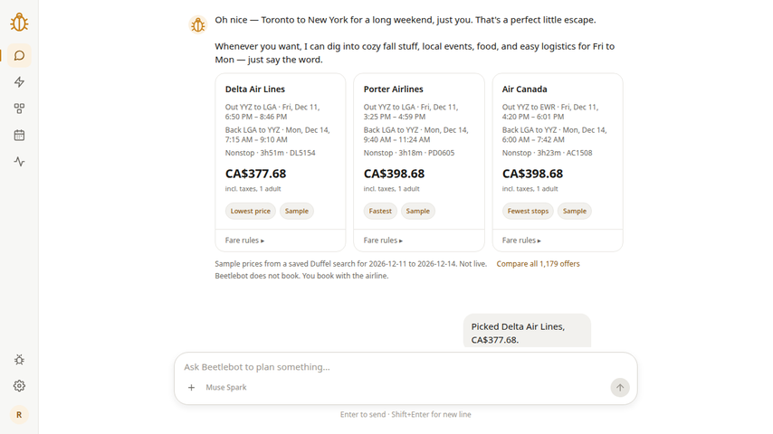
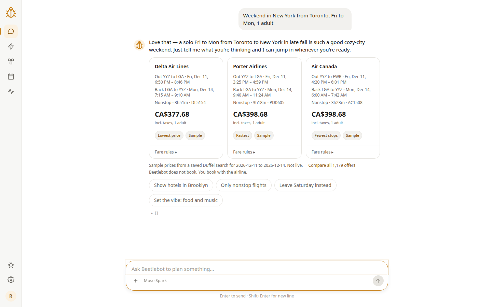
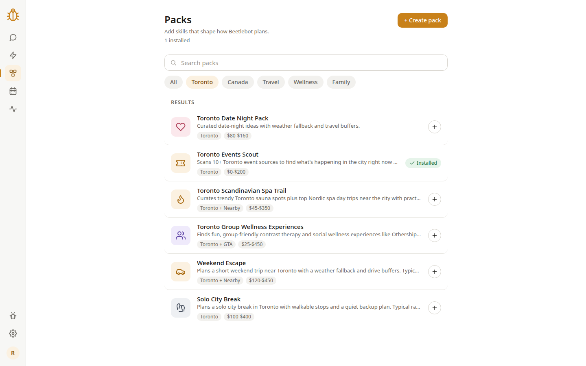
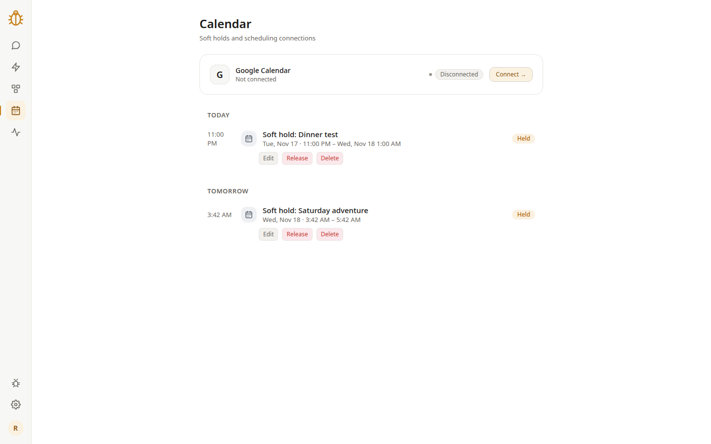
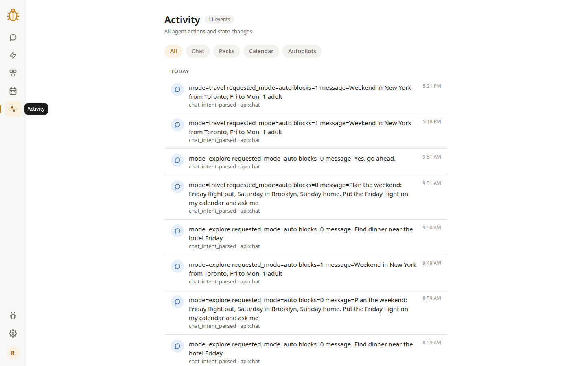
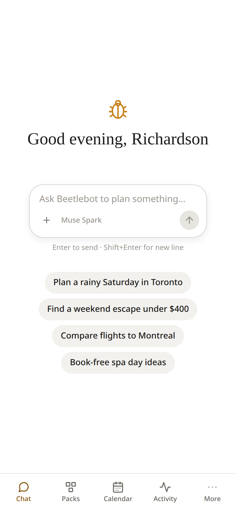
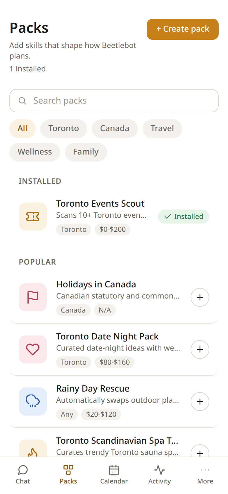
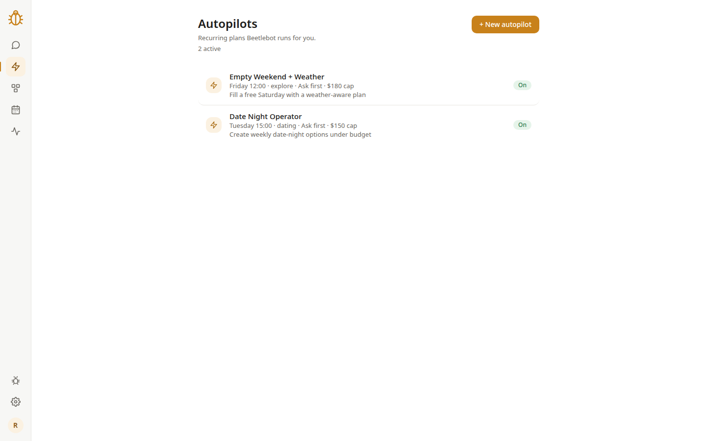
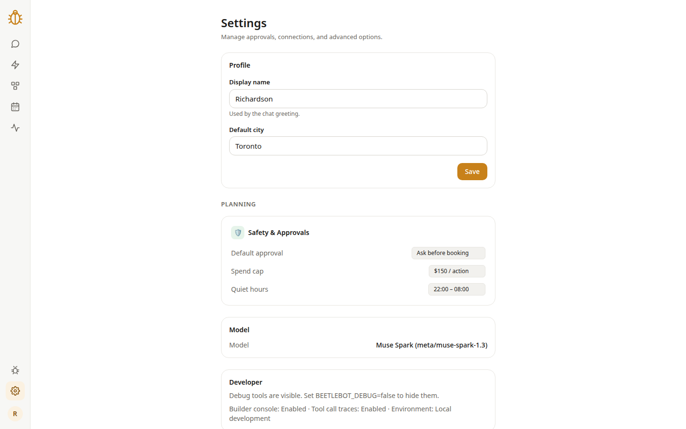
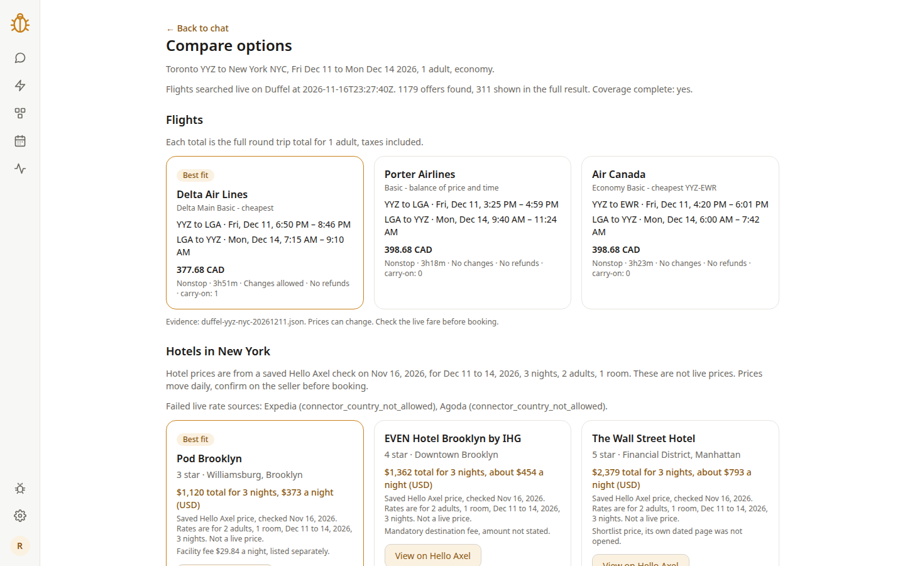

# 🪲 Beetlebot — Your Autonomous Life Agent

<p align="center">
  
</p>

<p align="center">
  
</p>

<h3 align="center">An open-source AI agent that plans your weekends and trips.</h3>

<p align="center">
  Ask in chat and get flight and hotel cards with live prices, side by side.<br />
  Pick the one you want, then book it directly with the airline or hotel.
</p>

<p align="center">
  <a href="#quickstart"></a>
  <a href="https://github.com/richardsondx/beetlebot/releases"></a>
  <a href="https://discord.gg/TWuKqaZxuc"></a>
  <a href="LICENSE"></a>
</p>

<p align="center">
  <a href="#quickstart">Quickstart</a> · <a href="#how-it-works">How it works</a> · <a href="#cli">CLI</a> · <a href="docs/">Docs</a> · <a href="#the-colony">The Colony</a> · <a href="https://discord.gg/TWuKqaZxuc">Discord</a>
</p>

<p align="center">
  <strong>Flight and hotel cards in chat, side by side. Tap one to select it.</strong><br />
  <strong>Live flight prices from Duffel. Saved searches are labeled Sample.</strong><br />
  <strong>City packs and autopilots for your free time, using your calendar, weather and memory.</strong>
</p>

> **Example search** (live Duffel results, run Nov 16, 2026): Toronto to New York, Dec 11 to 14, 2026, 1 adult, economy. 1,179 offers. Cheapest totals: Delta 377.68 CAD, Porter 398.68 CAD, Air Canada 398.68 CAD. Prices change, so your search will show current fares.
>
> Hotel cards use Hello Axel prices. If a hotel price is for 2 adults and your trip is for 1, the card says so.

<video src="docs/showcase/demo-480p.mp4" poster="docs/showcase/demo-poster.png" width="100%" controls></video>

[](docs/showcase/demo-480p.mp4)

> A 31-second screen recording of the real app with real model replies (Muse Spark), Nov 17, 2026. Ask for a weekend in New York. Beetlebot shows flight cards side by side with prices, and you tap Delta. It then shows hotel cards, answers a dinner question from a chip, and you send the itinerary request. The recording ends there. It does not show the itinerary, a calendar hold, or an approval step. Flight prices come from a saved Duffel search and are labeled "Sample" on screen. Hotel prices are saved Hello Axel rates checked Nov 16, 2026. 480p.

---


**Beetlebot** is an open-source AI agent that _autonomously_ plans your social life, weekend adventures, travel, and downtime. It reads your calendar, watches the weather, understands the season, knows your budget, learns your taste — and acts. Not a chatbot you talk _at_. A personal assistant that works _for_ you.

Other tools give you text. Beetlebot gives you your time back.

> The first time you wake up to a fully planned weekend you didn't have to think about — that's the moment. This is what AI was supposed to feel like.

## Plan my weekend

Ask in chat: "Plan my weekend in New York, Friday Dec 11 to Monday Dec 14, 2 adults, 1 room."

1. **Compare.** Beetlebot shows flight cards and hotel cards side by side with prices. Flights come from Duffel. Hotels use saved Hello Axel rates, with the source and date shown.
2. **Pick.** Tap the flight and hotel you want. The cards stay in the thread so you can come back to them.
3. **Itinerary.** Ask for a plan and it drafts the weekend day by day, around the flight and hotel you picked.
4. **Calendar.** With Google Calendar connected, it can add a hold for the flight.
5. **Approval.** It asks you before it changes anything, such as adding that hold.
6. **Book.** You book the flight and hotel yourself, with the airline or hotel. Beetlebot plans. It does not book.

The demo above covers steps 1 and 2 and ends as the itinerary request is sent. Steps 3 to 5 are not in the video yet. The calendar hold needs Google Calendar credentials, which the recording setup did not have.

## Showcase

| In chat | Packs | Calendar |
|---|---|---|
|  |  |  |
| Ask in chat and the flight cards appear in the thread, side by side. Tap the one you want. Prices from a saved Duffel search, marked Sample, not live. | Packs as a plugins directory, each with a visual icon. 1 installed here. | Holds grouped by day, Today first, with a collapsed Past. |

| Activity | Chat on phone | Packs on phone |
|---|---|---|
|  |  |  |
| Every agent action grouped by Today, Yesterday, and date. | Chat is the main screen, with the bottom tab bar on phone. | Installed and Popular packs, each with a visual icon. |

| Autopilots | Settings | Compare options |
|---|---|---|
|  |  |  |
| Recurring plans Beetlebot runs for you. 2 active here, each with an On switch. | Profile, approvals, spend cap, and the model in use: Muse Spark, meta/muse-spark-1.3. | The full compare page, flights and hotels side by side. Flights from the Duffel search on Nov 16, 2026; hotel prices from a saved Hello Axel check, not live. |

Screenshots from the real app, Nov 17, 2026. Flight prices are from the Duffel search on Nov 16, 2026, and will differ now.

## Highlights

- **Autonomous by default** — Beetlebot doesn't wait for you to ask. It monitors your calendar, checks the forecast, and acts when the moment is right. You set the goal once — it takes it from there.
- **Autopilots** — goal + trigger + action. "Empty Weekend + Rain" fires Friday at noon and books an indoor plan before you even open your phone.
- **Packs** — community-built planning skills for your city. Toronto Date Night. Rainy Day Rescue. Cottage Weekend. Install a pack or build your own.
- **Modes** — Auto picks the best planning type by default, or switch to Explore, Date Night, Family, Social, Travel, Relax, or Focus. Different priorities, different actions, same intelligence.
- **Memory** — learns your preferences, remembers your history, and gets better over time. Local-first — your data never leaves your machine.
- **Multi-channel** — talks to you on web chat, Telegram, WhatsApp. Meets you where you already are.
- **Soft-holds** — proactively reserves time on your calendar, then follows through. No more "I should have booked that."
- **Smart guardrails** — you control what runs on autopilot and what needs a thumbs-up. Full audit trail on every action.

## How it works

```
Chat, Telegram, WhatsApp
        │
        ▼
Beetlebot runtime (Next.js + TypeScript)
  Autopilot engine · Plan compiler · Memory
        │
        ▼
Calendar · Weather · Guardrails (you control)
```

## Quickstart

Runtime: **Node >= 18**.

```bash
git clone https://github.com/richardsondx/beetlebot.git
cd beetlebot
npm install
cp .env.example .env   # then fill in your keys (see below)
npm run db:push         # push schema to local SQLite
npm run dev
```

Open [http://localhost:3000](http://localhost:3000).

That's it. The beetle is alive.

### Environment variables

Copy `.env.example` to `.env` and configure:

```bash
# Required for local dev and self-host
DATABASE_URL="file:./dev.db"
ENCRYPTION_KEY="<generate with: openssl rand -base64 32>"

# Required — at least one AI provider
OPENAI_API_KEY=sk-...
ANTHROPIC_API_KEY=sk-ant-...
OPENROUTER_API_KEY=sk-or-...
```

Default model Muse Spark, meta/muse-spark-1.3, via OpenRouter.

Only needed when you want public callbacks/webhooks (OAuth, WhatsApp, Telegram webhooks):

```bash
NEXT_PUBLIC_APP_URL="https://xxxx.ngrok-free.app"
BEETLEBOT_BASE_URL="https://xxxx.ngrok-free.app"
```

### Self-hosting (private panel + public callbacks)

Recommended model:

- Keep Beetlebot private on the server (`127.0.0.1:48653`)
- Expose only callback/webhook paths through a local edge (`127.0.0.1:8787`)
- Tunnel the edge with ngrok (temporary or stable hostname)

This keeps the admin panel off the public internet while still enabling integrations like Google Calendar and WhatsApp.

For the full step-by-step setup (Caddy allowlist, ngrok config, systemd services, and verification), see:

- **[Self-hosting guide](docs/SELF_HOSTING.md)**

### Database

Beetlebot uses SQLite (via Prisma) — zero config, local-first.

```bash
npm run db:push        # Push schema to local SQLite
npm run prisma:generate # Generate Prisma client
```

### Encryption

Sensitive integration credentials (OAuth tokens, API keys) are encrypted at rest in the database using AES-256-GCM. Generate your key once and keep it in `.env`:

```bash
openssl rand -base64 32
# paste the output as ENCRYPTION_KEY in .env
```

## CLI

Beetlebot ships with a full CLI and interactive TUI.

```bash
npm run cli -- --help
```

### Key commands

```bash
beetlebot tui                              # Interactive terminal UI
beetlebot dev                              # Dev mode
beetlebot autopilot list                   # List autopilots
beetlebot autopilot run <id>               # Run an autopilot
beetlebot pack list                        # List installed packs
beetlebot pack install <slug>              # Install a community pack
beetlebot approvals list                   # Pending approvals
beetlebot memory list --bucket taste       # Inspect memory
beetlebot integrations list                # Integration status
beetlebot integrations connect telegram    # Connect Telegram
beetlebot svc restart                      # Restart beetlebot systemd service
beetlebot svc status ngrok                 # Check ngrok systemd service status
beetlebot svc endpoint                     # Print active ngrok public URL(s)
```

### TUI commands

Launch with `beetlebot tui`, then use:

| Command | Description |
|---|---|
| `/help` | Show all commands |
| `/status` | Session status |
| `/model set <provider/model>` | Switch AI model |
| `/autopilots` | List autopilots |
| `/packs` | Browse packs |
| `/runs` | Recent autopilot runs |
| `/approvals` | Pending approvals |
| `/memory [bucket]` | Inspect memory |
| `/connect <provider>` | Connect integration |
| `/new` | New conversation |
| `/context show` | Toggle context overlay |

**TUI keys:** `Enter` submit, `Ctrl+K` toggle context, `Ctrl+L` clear, `Ctrl+C` quit.

## Core concepts

### Autopilots

Tell the beetle what you care about. It figures out the when, the how, and the follow-through.

```
"Plan a date night when Saturday is open and weather is good"
  → Goal:    Date night
  → Trigger: Saturday free + clear forecast
  → Action:  Generate plan, hold calendar, book restaurant
  → Result:  You wake up Saturday with a plan ready to go
```

**Trigger classes:**
- **Time triggers** — cron-backed schedules (e.g., every Friday at noon).
- **Context triggers** — reacts to real-world changes (calendar opens up, weather shifts, budget resets).
- **Event triggers** — lifecycle events (booking fail, RSVP, birthday windows).

### Packs

Community-curated capability bundles for life planning.

```json
{
  "slug": "cottage-weekend-pack",
  "name": "Cottage Weekend Pack",
  "city": "Muskoka",
  "modes": ["family", "relax"],
  "budgetRange": "$120-$380",
  "description": "Plans cottage weekends with weather fallback, drive buffers, and grocery stop reminders."
}
```

Every city deserves a local expert. Build a pack, share it with the Colony.

### Memory

Beetlebot remembers everything — your preferences, your history, what worked and what didn't. The more you use it, the better it gets. All stored locally on your machine.

| Bucket | What the beetle learns |
|---|---|
| `profile_memory` | Who you are, your relationships, hard constraints |
| `taste_memory` | What you love, what you hate, your vibe |
| `logistics_memory` | How far you'll drive, your timing, budget defaults |
| `history_memory` | Past plans, outcomes, what landed and what flopped |

You can inspect, correct, or wipe any memory at any time. Your data, your machine, your rules.

### Soft-holds

The beetle proactively blocks time on your calendar when it spots an opportunity — then follows through with the full plan. No more "I should've booked that" moments.

## Integrations

### Google Calendar

Fully managed through the web UI — no env vars needed. Go to **Settings**, click **Connect** for Google Calendar, enter your OAuth client ID and secret, then sign in with Google. Beetlebot stores the credentials encrypted in the local database and handles token refresh automatically.

The OAuth callback URL is `<your-base-url>/api/integrations/google-calendar/callback` — register this in your Google Cloud Console.

```bash
# Or via CLI
beetlebot integrations connect google_calendar
```

### Telegram

```bash
beetlebot integrations connect telegram --bot-token <TOKEN>
# Or in TUI: /connect telegram botToken=<TOKEN>
```

### WhatsApp (Meta Cloud API)

```bash
beetlebot integrations connect whatsapp --access-token <TOKEN> --phone-number-id <ID>
```

## API routes

Full REST API for building on top of Beetlebot.

| Area | Endpoints |
|---|---|
| **Chat** | `POST /api/chat` |
| **Autopilots** | `GET/POST /api/autopilots`, `PATCH/DELETE /api/autopilots/:id`, `POST .../preview`, `POST .../run` |
| **Packs** | `GET/POST /api/packs`, `POST /api/packs/install` |
| **Calendar** | `GET /api/calendar/availability`, `POST/PATCH/DELETE /api/calendar/soft-holds` |
| **Memory** | `GET /api/memory`, `POST /api/memory/upsert`, `POST /api/memory/forget` |
| **Approvals** | `GET /api/approvals`, `POST /api/approvals/:id/approve\|reject` |
| **Weather** | `GET /api/weather/context` |
| **Integrations** | `GET/POST /api/integrations/:provider/connect\|disconnect\|test` |
| **Scheduler** | `GET /api/scheduler/jobs`, `POST /api/scheduler/reconcile` |
| **Audit** | `GET /api/audit`, `GET /api/debug/traces` |

## Stack

| Layer | Tech |
|---|---|
| Framework | Next.js 16 (App Router) |
| Language | TypeScript |
| Styling | Tailwind CSS v4 |
| Database | SQLite via Prisma |
| AI | Muse Spark via OpenRouter (meta/muse-spark-1.3), configurable |
| Tests | Vitest |
| CLI | Commander + tsx |
| Validation | Zod |

## Project structure

```
beetlebot/
├── app/                    # Next.js app (pages + API routes)
│   ├── (app)/              # App pages (chat, autopilots, calendar, packs, settings)
│   └── api/                # REST API routes
├── components/             # React components
├── lib/                    # Core runtime modules
│   ├── chat/               # Chat engine, safety, research loop
│   ├── runtime/            # Autopilot runner + scheduler
│   ├── repositories/       # Data access layer
│   ├── tools/              # Tool registry (weather, calendar, OpenTable)
│   ├── integrations/       # Channel adapters (Telegram, WhatsApp, Google)
│   └── weather/            # Weather service
├── packages/
│   ├── cli/                # CLI + TUI package
│   └── travel-cli/         # Travel planning CLI (Go)
├── prisma/                 # Database schema
├── docs/                   # Architecture + spec docs
└── tests/                  # Test suites
```

## Development

```bash
npm run dev          # Start dev server
npm run build        # Production build
npm run test         # Run tests
npm run lint         # Lint
npm run typecheck    # Type-check
npm run db:push      # Push Prisma schema
```

## Docs

Deep reference docs live in `docs/`:

- **[PRD](docs/PRD.md)** — product requirements
- **[Architecture](docs/ARCHITECTURE.md)** — system design and phases
- **[Autopilot Runtime](docs/AUTOPILOT_RUNTIME.md)** — trigger classes, execution guarantees
- **[Pack Spec](docs/PACK_SPEC.md)** — how to build a pack
- **[Memory Model](docs/MEMORY_MODEL.md)** — buckets, governance, user controls
- **[Plan Object Schema](docs/PLAN_OBJECT_SCHEMA.md)** — the plan contract
- **[API Routes](docs/API_ROUTES.md)** — full endpoint reference
- **[CLI](docs/CLI.md)** — commands, TUI, integration setup

## The Colony 🪲🪲🪲

Beetlebot isn't a product with a waitlist. It's a movement with a repo.

**The Colony** is the community building the autonomous life agent they actually want to use. No corporate roadmap. No feature gates. Just people who believe AI should handle the boring parts of life so you can live the interesting parts.

### How to contribute

- **Build Packs** — create planning skills for your city. Share local knowledge globally. Every city deserves a local expert.
- **Shape the roadmap** — the best features come from real people with real weekends. Open issues, open PRs, open conversations.
- **Fork it. Own it.** — open source means your agent, your rules. Self-host it, extend it, make it yours. No vendor lock-in. Ever.

See [CONTRIBUTING.md](CONTRIBUTING.md) for guidelines.

### Community channels

- **[Discord](https://discord.gg/TWuKqaZxuc)** — join The Colony
- **[GitHub Issues](https://github.com/richardsondx/beetlebot/issues)** — bugs, features, ideas
- **[GitHub Discussions](https://github.com/richardsondx/beetlebot/discussions)** — questions, show & tell

AI/vibe-coded PRs welcome.

## Why I built this

> **DRAFT — Richardson to rewrite in his own words before this is published.**
>
> I built Beetlebot because I wanted an agent that acts on my free time instead of waiting to be asked. Odessia showed that one conversation could plan and book a whole trip, then it shut down when OpenAI acquired it. Beetlebot is the open version of that idea, proactive instead of reactive: it watches my calendar and the weather, plans around what I like, and hands me the booking. My data stays on my machine, and the code is open so anyone can run their own.

## Author

Built by **[Richardson Dackam](https://x.com/richardsondx)** ([@richardsondx](https://x.com/richardsondx)) while Beetlebot handled his weekends.

## License

[MIT](LICENSE) — the beetle is free. Always.
